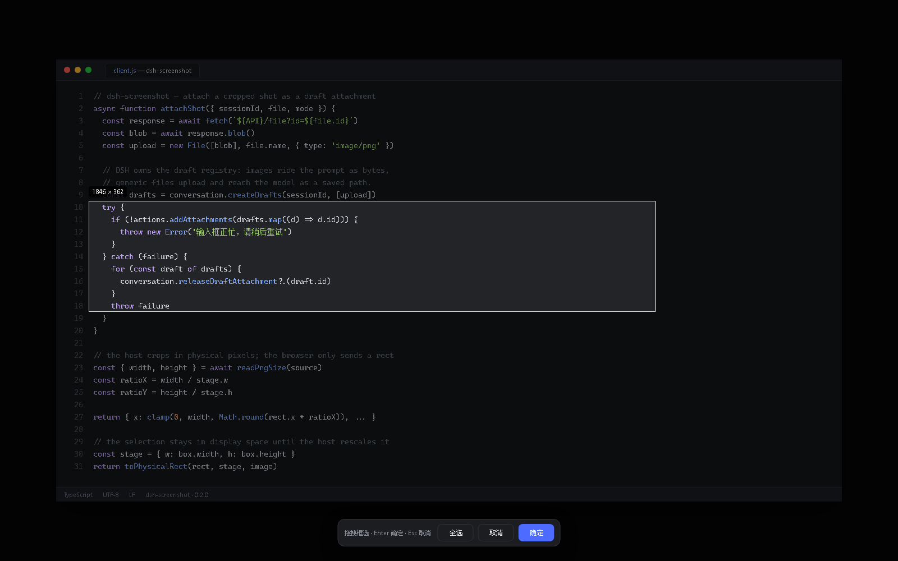

# dsh-screenshot — 对话框截图插件（微信 PC 式）

给 [DeepSeek Harness](https://github.com/deepseek-ai/deepseek-harness)（DSH）的 Web 输入框加一个「截图」按钮：点一下 → 遮罩框选（或先隐藏 DSH 窗口再截）→ 确认后**裁剪好的截图直接出现在输入框的附件栏里**，回车就能发。

从 0.2 起，截图走 DSH 自己的草稿附件通道：图片会作为真正的图片附件随消息发送，模型直接看到图；不再往草稿里塞 `截图：<路径>`，也不再需要 vision MCP。对不支持图片的模型，可以在菜单里切到「以文件路径发送」。



> 界面示意（演示数据）：遮罩框选后点「确定」，截图会进入输入框的附件栏。

## 功能

- **三种截法**：截取屏幕区域 / 隐藏 DSH 窗口后截图 / 截取全部屏幕（多显示器）
- **微信式框选**：全屏遮罩、拖拽选区、实时显示物理像素尺寸，支持「全选 / 取消 / 确定」、`Enter` 确认、`Esc` 取消
- **服务端裁剪**：Host 用 PowerShell 裁图，浏览器只上报显示坐标和画布尺寸；用 PNG 真实宽高换算物理像素，不受浏览器缩放、系统 DPI、CSS 影响
- **原生附件**：裁剪结果交给 `ctx.conversation.createDrafts` + `inputActions.addAttachments`，由 DSH 渲染附件卡、发送图片字节
- **失败可见**：截图失败、输入框正忙、附件过大都会 toast 提示，不再静默吞掉
- **崩溃自恢复**：隐藏窗口模式在被强杀后会由 Host 依据 `.hwnd` 标记把窗口恢复回来
- 取消/发送后自动清理临时文件，超过 30 分钟的残留由后台清扫

## 安装

### 从 GitHub 安装

先确认你用的是哪个 profile：桌面端是 `desktop`，`dsh web` 命令行一般是 `web`。

```bash
# 桌面端
dsh plugin --profile desktop add github:XEsx630/dsh-screenshot

# 或 dsh web
dsh plugin --profile web add github:XEsx630/dsh-screenshot

# 指定版本
dsh plugin --profile desktop add "github:XEsx630/dsh-screenshot#v0.2.0"
```

`dsh.bundle` 清单会自动把插件挂进 profile。重启 DSH 并刷新页面。

### 本地开发安装

```bash
dsh plugin --profile desktop add link:E:/path/to/dsh-screenshot
# 然后在 ~/.dsh/profiles/desktop 里 pnpm install，重启
```

## 使用

1. 点输入框左侧的「📷 截图」，选一种截法
2. 等遮罩里的画面加载完，按住左键拖出一个区域
3. 点「确定」（或按 `Enter`）→ 截图进入输入框上方的附件栏
4. 继续打字或直接发送；不想发了就在附件卡上点 ×

菜单底部可以切换发送方式：

| 方式 | 模型拿到什么 | 适用 |
|---|---|---|
| **以图片附件发送**（默认） | 图片内容（DSH 图片附件） | 支持视觉的模型；无需额外工具 |
| 以文件路径发送 | 一段指向只读保存路径的文本 | 纯文本模型 + 本地 vision/OCR 工具；或截图超过 6 MB 时自动降级 |

## 架构

```
┌─ 浏览器 ─────────────────────────────────────────────┐
│ 截图按钮 ──POST /capture──▶ 截图预览（GET /preview）   │
│    │                            │                    │
│    └── 遮罩拖拽（只算坐标）      │                    │
│         └──POST /crop {rect, stage}──▶ 裁剪好的 PNG    │
│                                        │             │
│ 取回 Blob ──▶ new File ──▶ createDrafts + addAttachments
└────────────────────────────────────────┼─────────────┘
                                         ▼
                              输入框附件栏（DSH 原生）
```

Host 侧：

1. `screenshot.ps1` 抓屏（可选先隐藏前台窗口，DPI 感知），写临时 PNG
2. 浏览器显示预览、拖拽选区
3. `crop.ps1` 按 PNG 真实尺寸换算后的物理像素裁剪
4. 裁剪结果通过 `GET /file` 交给浏览器，随后删除

设计取舍：

- **裁剪放服务端**：浏览器只做显示和坐标换算，避免 canvas 解码时序、`naturalWidth=0`、CSS 缩放带来的 1×1 空图
- **坐标换算以 PNG 真实尺寸为准**：`物理 = 显示坐标 × (PNG 宽 / 画布宽)`，浏览器缩放和 DPI 缩放都被吸收
- **图片字节走附件通道**：不再依赖 `$DSH_HOME/uploads` 路径，也不需要把路径塞进 prompt
- **隐藏窗口有崩溃兜底**：`screenshot.ps1` 隐藏前写 `<png>.hwnd` 标记，正常路径删除；进程被强杀时 Host 读标记调 `restore.ps1` 恢复

## HTTP API（Host）

所有接口仅限本机回环地址，且要求同源。

| 方法 | 路径 | 说明 |
|---|---|---|
| POST | `/api/screenshot/capture` | body `{hideWindow?, allScreens?}` → 抓屏到临时 PNG，返回 `{id, width, height, url}` |
| POST | `/api/screenshot/crop` | body `{id, rect:{x,y,w,h}, stage:{w,h}}` → 裁剪，返回 `{id, name, bytes, width, height, url}` |
| GET | `/api/screenshot/preview?id=` | 抓屏预览 |
| GET | `/api/screenshot/file?id=` | 裁剪结果 |
| DELETE | `/api/screenshot/preview?id=` / `file?id=` | 删除临时文件 |

## 安全

- 路由只接受回环 `Host`（`127.0.0.0/8`、`localhost`、`::1`），拒绝 `sec-fetch-site: cross-site` 和跨源 `Origin`
- `id` 必须是 UUID，文件名由 Host 生成，不接受外部路径
- 请求体上限 16 KB；响应 `no-store`、`nosniff`
- 截图和裁剪全部在本机 PowerShell 中完成，不上传任何数据
- 临时文件目录：`$DSH_HOME/cache/dsh-screenshot`（可用 `DSH_SCREENSHOT_DIR` 重定向），30 分钟 TTL

## 兼容性

- **DSH ≥ 0.2**（依赖 `ctx.conversation.createDrafts` / `inputActions.addAttachments` 与 `fileUpload` 服务）
- **Windows**：PowerShell 5.1 + .NET Framework 的 `System.Drawing` / `System.Windows.Forms`
- 客户端注入 `@deepseek-ai/dsh-client-runtime`、`dsh-client-ui-conversation`、`dsh-client-file-upload`

## 开发

```bash
node --test            # 单元测试 + PowerShell 裁剪测试
npm run check          # 语法检查

# 真实抓屏测试（会截当前屏幕）
$env:DSH_SCREENSHOT_LIVE=1; node --test test/powershell.test.js
```

测试覆盖：坐标换算/边界钳制、PNG 头解析、信任栅栏、路由校验与错误码、`crop.ps1` 的真实裁剪与越界拒绝。CI 在 `windows-latest` 上跑 Node 22/24。

## 故障排查

| 现象 | 处理 |
|---|---|
| 按钮是灰的 | 当前会话未就绪，或输入框处于命令提交/发送阶段 |
| 「截图失败：无法启动 PowerShell」 | 检查 `powershell.exe` 是否在 PATH；企业策略可能禁用 `Add-Type` |
| 图片发送失败 | 模型不支持图片输入，或图片超出部署限制 → 菜单里关掉「以图片附件发送」 |
| 窗口没恢复 | 重新打开 DSH；残留标记会在下次启动时被清扫并恢复窗口 |

## License

MIT
